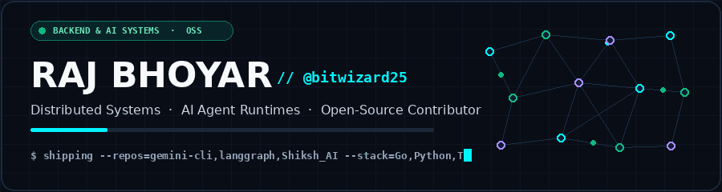

<div align="center">



<br />

<a href="https://bitwizard.vercel.app/">
  
</a>

<br />

[](https://bitwizard.vercel.app/)
[](https://www.linkedin.com/in/raj-bhoyar-b597b416a)
[](https://zenodo.org/records/24387983)
[](https://www.kaggle.com/code/rajbhoyar/neuroresearch)
[](https://leetcode.com/u/raj729/)
[](mailto:rbhoyar729@gmail.com)

</div>

<br />

### `$ whoami`

```yaml
name:      Raj Bhoyar
role:      Backend & AI Systems Engineer
builds:    [low-latency Go services, voice/LLM pipelines, agent memory]
ships_to:  [google-gemini/gemini-cli, langchain-ai/langgraph]
research:  "Bounded episodic memory for LLM agents (Zenodo DOI)"
motto:     "Measure it, then ship it."
```

<br />

### 🔧 Open-Source Contributions

* **[`google-gemini/gemini-cli#30473`](https://github.com/google-gemini/gemini-cli/pull/30473)** *(fixes [#30446](https://github.com/google-gemini/gemini-cli/issues/30446))* — Fixed context collapse in `collapseOlderFunctionResponses` by adding `calculateRetainedTurnByteSize` so evicted base64 image payloads no longer exhaust the 64 KB exempt retrieval budget and collapse earlier `read_file`/`grep` outputs. Backed by parameterized Vitest regression tests (`nested`, `sibling`, absent-response).
* **[`langchain-ai/langgraph#9802`](https://github.com/langchain-ai/langgraph/pull/9802)** *(fixes [#9791](https://github.com/langchain-ai/langgraph/issues/9791))* — Aligned `InMemoryStore.search(filter=...)` with PostgreSQL JSONB by requiring key existence (stopping missing keys from matching `None`) and guarding `$gt`/`$gte`/`$lt`/`$lte` against `ValueError`/`TypeError` crashes on heterogeneous types.
* **[`langchain-ai/langgraph#9803`](https://github.com/langchain-ai/langgraph/pull/9803)** *(fixes [#9792](https://github.com/langchain-ai/langgraph/issues/9792))* — Eliminated `bool` vs `int`/`float` filter conflation (`0`/`False`, `1`/`True`) across `InMemorySaver`, `SqliteSaver`/`AsyncSqliteSaver` (via SQLite `json_type`), and `InMemoryStore` with sync & async regression coverage.

<br />

### ⚡ Live Systems Architecture

<div align="center">
  <a href="https://github.com/bitwizard25/Shiksh_AI">
    
  </a>
</div>

* **[Shiksh_AI](https://github.com/bitwizard25/Shiksh_AI)** — Open-source Go multilingual voice tutor streaming ASR → Gemini LLM → parallel Bhashini TTS with circuit breakers, failover, and Dockerized deployment.
* **[DevPulse-AI](https://github.com/bitwizard25/DevPulse-AI)** & **[inventory_management_system](https://github.com/bitwizard25/inventory_management_system)** — Full-stack Python/TypeScript analytics and modular SaaS backend systems.

<br />

### 🧠 Independent AI Memory Research

<div align="center">
  <a href="https://zenodo.org/records/24387983">
    
  </a>
</div>

Published on **[Zenodo (DOI: 10.5281/zenodo.24387983)](https://zenodo.org/records/24387983)** with full reproducible experiments on **[Kaggle](https://www.kaggle.com/code/rajbhoyar/neuroresearch)** — demonstrating that selective write gating into 24 bounded slots achieves **`0.93 ± 0.03`** held-out 1–3 day recall vs. **`0.51`** for write-all and **`0.17`** for unlimited RAG.

<br />

### 🛠️ Tech Stack

<div align="center">
  
</div>

<br />

<div align="center">

**Open to backend, infra and applied-AI roles — let's talk.**

[](mailto:rbhoyar729@gmail.com)


</div>
