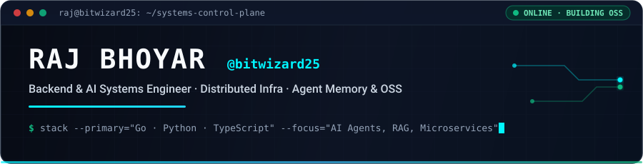

<div align="center">



<br/>

[](https://bitwizard.vercel.app/)
[](https://www.linkedin.com/in/raj-bhoyar-b597b416a)
[](https://zenodo.org/records/24387983)
[](https://leetcode.com/u/raj729/)
[](https://medium.com/@rbhoyar729)
[](mailto:rbhoyar729@gmail.com)

<br/>


</div>

---

## `$ cat /etc/raj.conf`

```yaml
name       : Raj Bhoyar
location   : India
role       : Backend & AI Systems Engineer
languages  : Go · Python · TypeScript · C++
focus      : AI agent runtimes · persistence & retrieval parity · Go microservices · streaming pipelines
research   : Bounded episodic agent memory & selective write gating (Zenodo DOI: 10.5281/zenodo.24387983)
motto      : "Ship clean, testable systems that hold up past the demo."
```

---

## `$ git log --author="bitwizard25" --oss`

Recent open-source engineering contributions focused on AI agent context management and cross-backend persistence parity:

| Repository | Pull Request | Problem Solved | Verification |
| :--- | :--- | :--- | :--- |
| **[google-gemini/gemini-cli](https://github.com/google-gemini/gemini-cli)** | **[#30473](https://github.com/google-gemini/gemini-cli/pull/30473)** *(fixes [#30446](https://github.com/google-gemini/gemini-cli/issues/30446))* | Prevented evicted base64 image payloads from exhausting the 64 KB exempt retrieval budget and collapsing earlier `read_file`/`grep` context | Parameterized Vitest regression suite (`nested`, `sibling`, absent-response) |
| **[langchain-ai/langgraph](https://github.com/langchain-ai/langgraph)** | **[#9802](https://github.com/langchain-ai/langgraph/pull/9802)** *(fixes [#9791](https://github.com/langchain-ai/langgraph/issues/9791))* | Separated missing keys from explicit `None` in `InMemoryStore` filters and guarded `$gt`/`$gte`/`$lt`/`$lte` against heterogeneous type crashes | Pytest regression suite (`119/119` passing) + `ruff` |
| **[langchain-ai/langgraph](https://github.com/langchain-ai/langgraph)** | **[#9803](https://github.com/langchain-ai/langgraph/pull/9803)** *(fixes [#9792](https://github.com/langchain-ai/langgraph/issues/9792))* | Fixed `bool` vs `int`/`float` filter conflation across `InMemorySaver`, `SqliteSaver`/`AsyncSqliteSaver` (via SQLite `json_type`), and `InMemoryStore` | Sync & async Pytest suites across checkpoint & SQLite (`150/150` passing) |

---

## `$ cat research/preprint.md`

### [Selective Write Gating vs. Neuromodulation in Bounded Episodic Agent Memory](https://zenodo.org/records/24387983)
> **Zenodo Preprint** · DOI [`10.5281/zenodo.24387983`](https://zenodo.org/records/24387983) · [45-Run Kaggle Ablation Notebook](https://www.kaggle.com/code/rajbhoyar/neuroresearch)

* Controlled **45-run ablation** (9 memory variants × 5 seeds, 4,000 simulated days/run, 24 bounded memory slots) evaluating what actually drives multi-day episodic recall in LLM agents.
* Demonstrated that **selective write gating** into 24 bounded slots achieves **`0.93 ± 0.03`** held-out 1–3 day recall vs. **`0.51`** for write-all and **`0.17`** for unlimited RAG retrieval.

---

## `$ ls -la ~/featured-systems`

### 1. [Shiksh_AI](https://github.com/bitwizard25/Shiksh_AI) — Multilingual Voice AI Tutor *(Go · Streaming · Docker)*
Open-source Go-based voice tutor for Indian languages engineered for low-latency streaming and fault tolerance.

<details>
<summary><b>Inspect streaming pipeline architecture</b></summary>

```text
[User Audio] ──▶ [ASR] ──▶ [Gemini LLM Stream] ──▶ [Parallel Bhashini TTS] ──▶ [Audio Stream]
                                  │                          │
                          Circuit Breakers            Failover & Retries
```

</details>

### 2. [DevPulse-AI](https://github.com/bitwizard25/DevPulse-AI) & [inventory_management_system](https://github.com/bitwizard25/inventory_management_system)
Full-stack developer analytics and production SaaS backend/UI systems built with **Python**, **TypeScript**, **Node.js**, **PostgreSQL**, and **Next.js**.

---

## `$ env | grep STACK`

<div align="center">

**Languages**


**Backend, Data & Messaging**


**AI, Frontend & Cloud**


</div>

---

## `$ top --github-telemetry`

<div align="center">


<br/>


</div>

---

<div align="center">
  <code>raj@bitwizard25:~$ echo "Always down to talk distributed systems, agent memory, or open source."</code>
</div>
