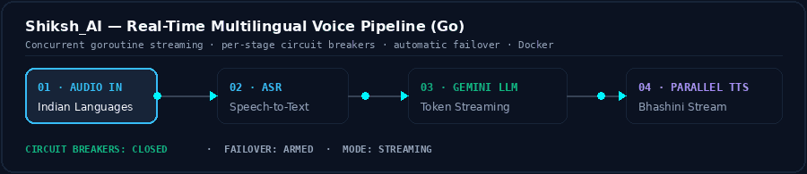
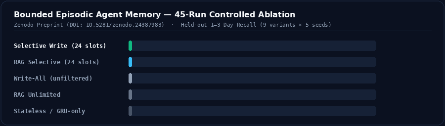

<div align="center">


<br />

<a href="https://bitwizard.vercel.app/">
  
</a>

<br />

[](https://bitwizard.vercel.app/)
[](https://www.linkedin.com/in/raj-bhoyar-b597b416a)
[](https://zenodo.org/records/24387983)
[](https://www.kaggle.com/code/rajbhoyar/neuroresearch)
[](https://leetcode.com/u/raj729/)
[](mailto:rbhoyar729@gmail.com)

<br /><br />

<sub><b>Available for TypeScript, Go &amp; AI backend contracts or full-time roles</b> — see PRs in <a href="https://github.com/google-gemini/gemini-cli/pull/30473">gemini-cli</a>, <a href="https://github.com/calcom/cal.diy/pull/30647">cal.diy</a>, and <a href="https://github.com/bitwizard25/Shiksh_AI">Shiksh_AI</a> · <a href="mailto:rbhoyar729@gmail.com?subject=Engineering%20Contract%20%2F%20Role%20Inquiry">Book a quick chat</a></sub>

</div>

<br />

<table>
<tr>
<td width="58%" valign="top">

### 👋 Hey, I'm Raj

I build **backend systems that talk to AI** — real-time Go voice pipelines, LLM agent memory, and the boring-but-critical plumbing that keeps them up.

- 🔭 Building **[Shiksh_AI](https://github.com/bitwizard25/Shiksh_AI)** — a streaming multilingual voice tutor
- 🧪 Researching **bounded episodic memory** for LLM agents
- 🔧 Fixing bugs in **Gemini CLI**, **Cal.diy**, and **LangGraph**
- 💼 Open to **contract, freelance & full-time** backend / infra / applied-AI work

</td>
<td width="42%" valign="top">

```yaml
name:   Raj Bhoyar
role:   Backend & AI Systems Engineer
langs:  [Go, Python, TypeScript, C++]
infra:  [Docker, AWS, Kafka, Redis]
focus:
  - low-latency streaming
  - LLM agent memory
  - reliability (breakers, failover)
```

</td>
</tr>
</table>


## 🔧 Open-Source Contributions

<table>
<tr>
<td align="center" width="33%">
<a href="https://github.com/google-gemini/gemini-cli/pull/30473"></a><br />
<b><a href="https://github.com/google-gemini/gemini-cli/pull/30473">gemini-cli #30473</a></b><br />
<br />
<sub>Stopped base64 image payloads from exhausting the 64 KB budget and collapsing earlier tool outputs.</sub>
</td>
<td align="center" width="33%">
<a href="https://github.com/langchain-ai/langgraph/pull/9802"></a><br />
<b><a href="https://github.com/langchain-ai/langgraph/pull/9802">langgraph #9802</a></b><br />
<br />
<sub>Made <code>InMemoryStore</code> filters match PostgreSQL JSONB and stopped comparison crashes on mixed types.</sub>
</td>
<td align="center" width="33%">
<a href="https://github.com/langchain-ai/langgraph/pull/9803"></a><br />
<b><a href="https://github.com/langchain-ai/langgraph/pull/9803">langgraph #9803</a></b><br />
<br />
<sub>Fixed <code>0</code>/<code>False</code> and <code>1</code>/<code>True</code> mix-ups across in-memory and SQLite savers.</sub>
</td>
</tr>
<tr>
<td align="center" width="33%">
<a href="https://github.com/google-gemini/gemini-cli/pull/30489"></a><br />
<b><a href="https://github.com/google-gemini/gemini-cli/pull/30489">gemini-cli #30489</a></b><br />
<br />
<sub>Normalized CRLF line endings in <code>write_file</code> diffs while preserving CRLF on disk.</sub>
</td>
<td align="center" width="33%">
<a href="https://github.com/google-gemini/gemini-cli/pull/30490"></a><br />
<b><a href="https://github.com/google-gemini/gemini-cli/pull/30490">gemini-cli #30490</a></b><br />
<br />
<sub>Passed <code>config</code> to <code>getDisplayString</code> in <code>Footer.tsx</code> so custom Vertex AI model names render.</sub>
</td>
<td align="center" width="33%">
<a href="https://github.com/calcom/cal.diy/pull/30647"></a><br />
<b><a href="https://github.com/calcom/cal.diy/pull/30647">cal.diy #30647</a></b><br />
<br />
<sub>Allowed legacy admin passwords to verify via <code>verifyPassword()</code> during account deletion.</sub>
</td>
</tr>
</table>

## ⚡ Featured Builds

<div align="center">
  <a href="https://github.com/bitwizard25/Shiksh_AI">
    
  </a>
</div>

<p align="center">
  <a href="https://github.com/bitwizard25/Shiksh_AI"></a>
  <a href="https://github.com/bitwizard25/DevPulse-AI"></a>
</p>

## 🧠 Research — Bounded Episodic Agent Memory

<div align="center">
  <a href="https://zenodo.org/records/24387983">
    
  </a>

<br /><br />

| Memory strategy | Held-out 1–3 day recall |
|:--|:--:|
| 🥇 **Selective write gating (24 slots)** | **`0.93 ± 0.03`** |
| Write everything | `0.51` |
| Unlimited RAG | `0.17` |

<sub>45-run ablation · <a href="https://zenodo.org/records/24387983">Zenodo DOI 10.5281/zenodo.24387983</a> · <a href="https://www.kaggle.com/code/rajbhoyar/neuroresearch">reproduce on Kaggle</a></sub>
</div>

## 🛠️ Tech Stack

<div align="center">
  
</div>

## 📈 Activity

<div align="center">
  
</div>

<br />

<div align="center">

<a href="https://bitwizard.vercel.app/"><b>Portfolio</b></a> · <a href="https://www.linkedin.com/in/raj-bhoyar-b597b416a">LinkedIn</a> · <a href="mailto:rbhoyar729@gmail.com">Email</a>


</div>
